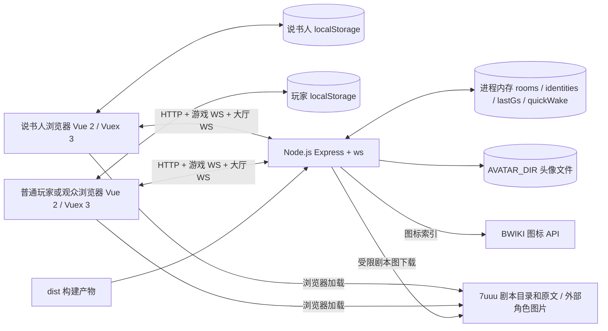
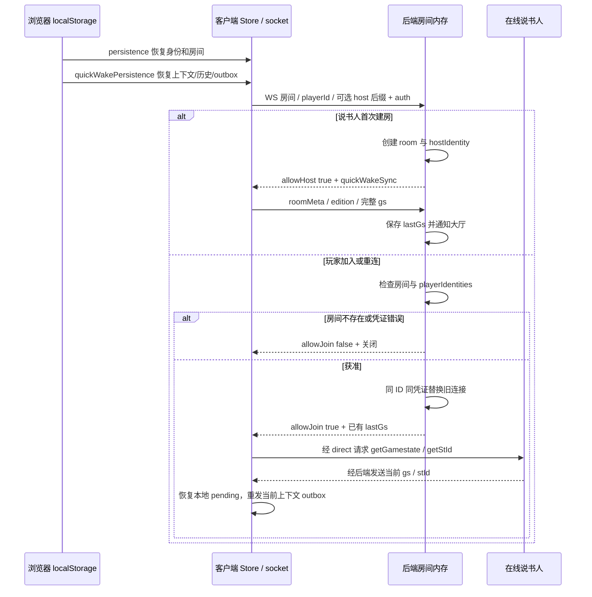
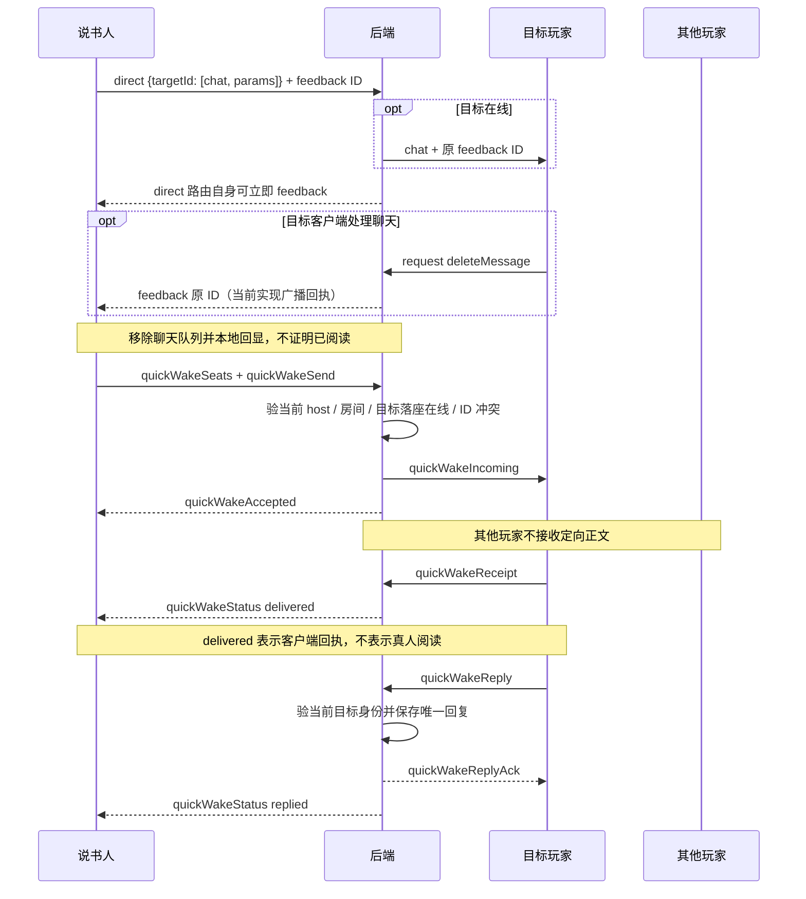

# 架构、状态归属与恢复

术语先读 [CONTEXT.md](../CONTEXT.md)。本页描述当前实现；命令参数与权限逐项见[协议文档](protocol.md)，验证入口见[测试说明](testing.md)。

## 系统拓扑

图标索引只从 BWIKI 获取；剧本图下载只走 7uuu 图片代理。图中两种后端外部访问对应不同端点，详见下文资源表。HTTP 和 WS 默认同源，分别提供静态页面/头像/动态配置，以及游戏房间和大厅消息。常规部署先构建 `dist`，再运行 `node server/index.js`；后端直接托管构建后的页面。

游戏规则与连接权威要分开理解。说书人浏览器决定角色、提醒、投票推进和盲抽分配；后端决定房间能否创建/加入、当前连接和已绑定凭证，并维护快速唤醒记录及定向回执。普通命令仍有通用广播分支，不能把界面隐藏按钮或前端 `_isSpectator` guard 写成服务端权限保证。后端既有状态，也没有成为完整游戏规则权威。

## 模块地图

| 位置 | 当前具体职责与边界 |
|---|---|
| [`src/main.js`](../src/main.js)、`src/App.vue` | Vue 启动、全局图标与构建版本；顶层界面、全局交互及模态框组合。导入 Store 时插件已开始初始化，不应假定挂载后才联网。 |
| [`src/store/index.js`](../src/store/index.js) | 组合四个模块；保存 `grimoire` 显示/日夜/夜次、剧本及角色定义 Map、模态框、版本；`newGame` 负责新开局的部分状态复位，`ensureWikiIcons` / `fetchInit` 获取 HTTP 数据。 |
| [`modules/players.js`](../src/store/modules/players.js) | `players` 座位数组、每座位身份/角色/生死/提醒/票权/夜间完成标记、`bluffs`、`fabled`、`stTokens`；计算存活人数与夜间顺序，处理交换/移动/角色清理；不是后端连接名册。 |
| [`modules/session.js`](../src/store/modules/session.js) | 本地身份与房间号、连接提示、`claimedSeat`、提名/投票/历史、聊天队列/历史/群组、角色开关、盲抽和计时器。既有值，也有 timeout、resolver 等运行句柄；不是全部都能序列化持久化。 |
| [`modules/lobby.js`](../src/store/modules/lobby.js) | 大厅 `roomList` 详情、兼容旧界面的 `rooms` 房间号数组、ping 与重连开关。列表内容由 `LiveLobby` 收到服务器快照/增删改后更新，不写入常规持久化。 |
| [`modules/quickWake.js`](../src/store/modules/quickWake.js) | 按上下文保存 `messagesByKey`，派生 pending 队列，维护发送/回复 outbox、单调状态合并、在线名单、目标与强制回复交互。消息文本/阶段/目标座位是发送时快照。 |
| [`src/logic/quickWake.js`](../src/logic/quickWake.js) | 文本片段组合、长度和空白处理、消息/回复构造、ID、阶段副本、历史键、去重、pending 顺序和预设列表操作；不打开网络或存储。 |
| [`persistence.js`](../src/store/persistence.js) / [`safeStorage.js`](../src/store/safeStorage.js) | 主页面 `/` 上恢复常规本地状态，然后订阅指定 mutation 保存；存储失败时降级为当前会话内存。多数 JSON 读取有保护，历史直接 `JSON.parse` 路径尚存。 |
| [`quickWakePersistence.js`](../src/store/quickWakePersistence.js) | 探测本地存储；恢复全局预设；按房间 + 玩家加载历史/outbox；切换上下文时关闭相关弹窗。对读取、写入或探测失败提供提示。 |
| [`src/store/socket.js`](../src/store/socket.js) | 同一文件包含 `LiveSession`、`LiveLobby` 及 Vuex 插件；负责连接/重连、帧分发、共享快照派生、私密展示、座位/投票/聊天/盲抽编排和 outbox 定时发送，不能笼统视为无业务的 transport。 |
| [`TownSquare.vue`](../src/components/TownSquare.vue) / [`Player.vue`](../src/components/Player.vue) / [`Vote.vue`](../src/components/Vote.vue) | 座位交互、聊天展示、定向唤醒入口、玩家操作与投票界面；显示座位号与数组下标在此转换。 |
| [`Menu.vue`](../src/components/Menu.vue) | 建房/加入/退出、角色与剧本操作、魔典/伪装授权展示、复盘、资源下载及本地清理等业务入口。 |
| `src/components/modals/` | `DirectedWakeModal` 组合信息并排入发送队列，`PlayerWakeModal` 顺序强制回复；`NightWakeModal` 是夜间顺序助手，`QuickWakeModal` 等旧界面不能与新专用协议混为一谈；`BlindDrawModal` 展示盲抽，`ScriptLibraryModal` 自行加载外部目录并保存收藏/最近导入。 |
| [`ImageCropper.vue`](../src/components/ImageCropper.vue) | 裁剪后以 HTTP 上传头像；socket 中仍保留另一条上传路径。两条路径均须核对。 |
| [`server/index.js`](../server/index.js) | Express HTTP、头像落盘、静态托管、外部资源代理、WS 升级与心跳、房间/身份/大厅、普通中转与快速唤醒专用处理、空房回收；所有房间状态在单进程 Map 中。 |

## 状态归属矩阵

“权威修改方”指正常产品流程的数据来源；对于普通游戏广播，不代表服务端已逐项阻止伪造。浏览器持久层均按同源隔离；没有特别注明的旧键并未按房间或玩家命名空间隔离。

| 状态 | 创建者 | 权威修改方 | 接收者 / 可见范围 | 内存或持久层 | 恢复方式 | 期限 / 清理 |
|---|---|---|---|---|---|---|
| 角色定义、剧本、阵营名、自定义夜序 | 内置 JSON、说书人导入 | 说书人选择；前端解析 | 房间客户端接收 `edition` 和相关配置；角色目录不等于角色分配 | Vuex；浏览器 `edition` / `roles` / `states` / `teamsNames` / `firstNight` / `otherNight` 等键 | persistence 恢复；在线由说书人重新发送 | 更换/覆盖或站点数据清除；无统一 TTL |
| host 私密魔典：普通角色分配、提醒、伪装 | 说书人 | 说书人浏览器 | 默认留本地；发角色/伪装/魔典时授权给目标，复盘可面向全房间；经后端路由 | Vuex `players` / `bluffs` 等；浏览器 `players`、`bluffs` | 本地恢复角色 ID 对应对象；说书人重新定向展示 | 换局/清角色按具体 mutation 复位；本地残留可继续保存，无统一过期 |
| 说书人标记 `stTokens` | 说书人 | 说书人 | 常规 `gs` 不含此字段；玩家接收完整 `gs` 会清除本地残留 | host Vuex、浏览器 `stTokens` | persistence 恢复 | `players/clear` 或手动移除/清理；无 TTL |
| 公开 `gs` / `lastGs` | 说书人派生 | host 浏览器；服务器只缓存符合条件的广播 | 房间玩家/观众；新加入者可获缓存 | 客户端 Vuex；服务端 `room.lastGs` 内存 | 玩家请求 host 当前状态；入房时服务器补发已有 `lastGs` | 下一次完整广播覆盖；房间销毁/重启丢失；**不保证增量之后仍最新** |
| 座位 `players[].id`、`claimedSeat` | 说书人创建空座位；玩家请求落座 | host 处理 `claim` 并发布；客户端跟踪自己座位 | 公开姓名、ID、头像和座位；与连接名册不同 | Vuex；浏览器 `players`、`claimedSeat`；服务器仅保留公开缓存及 quickWake 落座 ID 集合 | 本地先恢复意向；在线由 host 座位表确认 | 离座/移动/换位会改变下标；断线不等于该座位立即清空 |
| nomination / votes / lockedVote / 计时 | host 发起，玩家投票 | host 组织提名与锁票；客户端接收同步 | 常规全房间；闭眼投票针对接收者隐藏其他真实选择 | Vuex 与运行计时器；部分 `playerVotes`、`secretVote` 存浏览器；服务端没有完整投票规则状态机 | host 在线快照及后续消息；当前计时器句柄不能从本地完整恢复 | 结束提名、新开局或相关 mutation；非完整持久化 |
| 投票历史 / 选择 | 客户端在投票完成时生成 | 各浏览器记录；host 控制显示允许项 | 本地历史界面，受现有客户端允许开关影响 | Vuex `voteHistory` / `voteSelected`；浏览器 `votes` / `votesSelected` | persistence 逐条恢复 | 手动清历史、新开局；无服务端历史备份 |
| 盲抽与复盘 | host 开始/操作 | host 浏览器 | 盲抽公开 active/count/taken，角色经 direct 给抽取者；复盘可公开角色和非自定义提醒 | Vuex；后端有 `blindDraw` / `blindDrawTaken` / `reviewRevealed` 内存字段；部分复盘开关存本地 | host 快照/同步与定向结果；单独缓存字段不保证自动形成最新加入快照 | 结束盲抽/复盘或换局相关复位；后端重启清除 |
| 普通聊天发送队列 / 去重 | 发信浏览器 | 发信端 enqueue；`feedback` 删除任务 | direct 指定连接；群聊主要由 host 客户端转发 | `session.messageQueue` / `messageUniqueQueue` 内存，无服务端持久消息队列 | 运行中约每 1.5 秒重发未删任务；刷新后队列不恢复 | feedback 删队列；去重条目约 3 分钟；正常离房清队列；不是可靠离线投递 |
| 聊天历史 / 群组 / 未读提示 | 收发客户端；host 编排群组 | 各浏览器，群组由 host 发消息更新 | 对应聊天界面；未读计数是 UI 状态 | Vuex；浏览器 `chatHistory` / `groupChats`；未读数随本地状态 | persistence 恢复历史与成员 ID，再关联座位 | 本地清理/覆盖；无统一 TTL；feedback 和未读数均不证明实际阅读 |
| 房间 meta / 大厅列表 | host 上报 roomMeta；后端创建房间描述 | 后端筛选元数据字段，连接事件更新人数 | 大厅连接接收快照和增删改；不公开凭证 | 后端 `rooms` / `meta` / `lobbyClients`；前端 `lobby` 内存 | 大厅重连取 `setRooms`；host 重连上报 meta | 房间解散/空房回收/进程重启移除；在线人数不等于落座人数 |
| 本地身份 `playerId` / `stSecret` / `stId` | 浏览器生成 ID、随机秘密；host 提供公开 stId | 浏览器复用身份；服务器验证连接 | ID 与 stId 可公开；秘密只用于连接认证，不放进共享快照 | Vuex；浏览器独立键 | persistence 恢复，再以 `auth` 连接 | 清站点数据或主动覆盖前保留；无账号跨设备恢复 |
| `playerIdentities` / `hostIdentity` | 后端在首次获准连接时绑定 | 后端连接生命周期 | 服务器内部；客户端仅得允许/拒绝结果 | 房间内存：玩家 ID → auth，host 的 ID + auth；连接 Map 与身份绑定分开 | 玩家同 ID 必须同 auth；host 离线后重连匹配身份 | 玩家掉线后绑定仍留房间；房间删除/重启全部消失 |
| quickWake 消息/回复/投递状态 | host 发消息、目标回复 | 服务器专用路由校验并保存结果；客户端合并状态 | 正文仅相关 host 与目标；presence 名单可发全房间 | 服务端 `quickWake.records` / `order` 内存；客户端 `messagesByKey` 和本地历史 | host 同步自己的发送记录；目标从本地历史恢复，host 重交同 ID 可向已换连接的目标重投未回复消息 | 房间删除/重启清服务器记录；超过 500 时仅淘汰已回复记录，未回复可继续积累，现有记录达到 1000 时拒绝新消息；本地无 TTL |
| quickWake pending / outbox | 客户端由历史派生 pending；发送/回复 enqueue | 本地 mutation；服务器 accepted/status/ReplyAck 驱动确认 | 当前 roomId + playerId 的界面与连接 | Vuex；`quickWakeHistory:v1:<roomId>:<playerId>` 内保存 messages + outbox | 插件 hydrate，当前连接重发对应房间/身份任务 | accepted/status 移除发送任务，ReplyAck 移除回复任务；换上下文更换 outbox；本地历史并非服务器重启可靠投递保证 |
| quickWake presets | 使用者编辑 | 当前浏览器 | 当前浏览器跨房间使用 | Vuex + `quickWakePresets:v1` | 插件启动读取、规范化 | 删除预设/清站点数据；无 TTL，不按房间隔离 |
| 偏好和夜间助手 | 使用者 | 当前浏览器；共享日夜由 host 控制 | 缩放、背景、静音、wiki 图标开关主要本地；不能把整个 `grimoire` 对象都当私密偏好 | Vuex `grimoire` 及若干 session 开关；对应 localStorage 键；座位 `nightDone` 跟随 players 保存 | persistence 恢复 | 夜次和 nightDone 在新开局路径复位；偏好保留至修改/清除；增量 player 发送需逐字段检查 |
| 头像 | 用户裁剪/上传 | 服务器写文件；浏览器更新头像引用 | `/avatars/*` 静态公开；座位表可携带链接 | 文件 `AVATAR_DIR`，默认 `server/avatars`；浏览器 `playerAvatar` 只是引用 | 保留目录/部署卷后继续访问；本地引用不能重建丢失文件 | 同名上传可覆盖；无自动文件过期；HTTP 静态缓存最长 7 天不等于文件保存期限 |
| 外部资源缓存 / 剧本库偏好 | BWIKI、7uuu、图片来源 | 来源站点；后端/浏览器各自缓存 | 角色图标、目录、剧本原文、图片使用者 | 见下表；不是游戏存档 | 重新加载来源；收藏/最近导入读本地 | 各缓存规则独立，来源可变或不可用 |

## 插件顺序与 mutation 回流

[`src/store/index.js`](../src/store/index.js) 的顺序是 `persistence → quickWakePersistence → socket`。

1. `persistence` 在 `/` 路径先恢复剧本、魔典、身份、上次房间、座位及历史，再注册自己的 `subscribe`。此时 socket 插件还没有订阅，恢复 `setSessionId` 不会提前通过该订阅发起网络连接。
2. `quickWakePersistence` 读取预设，以已恢复的 `sessionId` 与 `playerId` 建立上下文并 hydrate 历史/outbox，然后订阅上下文变更和快速唤醒 mutation。
3. `socket` 创建大厅和游戏连接对象。大厅在 `/` 自动连接；`LiveSession` 构造时发现上次房间会连接；随后订阅 mutation。此后的 `setSessionId` 会连接/断开，其他已列举 mutation 会发网络消息。

网络接收也经 `commit` 改状态，因此同样触发 storage 与 socket 订阅。当前避免回流的方法分散在各个分支：`sendGamestate` / `sendPlayer` 等检查 host 模式；pronouns 使用 `isFromSockets`；投票把接收 `session/vote` 和发送 `session/voteSync` 分开。这里没有统一的“所有网络 mutation 自动静默”总开关，不能添加任意 commit 后就假定不会再发包。持久化可以保存接收后的状态，这是现有恢复方式的一部分。

存储回流也需要按分支检查。旧 `persistence` 初始化先于自身订阅，部分历史写入还用 `payload.save` 区分恢复和新增；快速唤醒的 `setContext` 仅切换键，订阅显式跳过保存，直到 `hydrateContext` 读完该键，避免用空历史覆盖已有存储。`quickWake/setStorageError` 被订阅排除，以免错误提示再次触发存储错误循环。这里的回流是 mutation 与读写的相互作用，并没有实现通用 `storage` 事件跨标签同步。

当前状态：初始化、连接 timeout 句柄、模态框部分交互及 `LiveLobby.setRooms/addRoom/updateRoom/removeRoom` 仍有直接 `store.state` 赋值；并不是每次变化都会产生 mutation，也不是每个值都会持久化。`safeStorage` 只包装旧 persistence 的访问，不覆盖组件中的所有直接 localStorage 使用。新代码建议：通过有明确接收/发送语义的 mutation 更新响应式状态，新增字段使用 `Vue.set` 或替换对象/数组，并为每条网络/持久化订阅明确回流 guard。这是维护约定，历史代码尚未统一迁移。

## 加入与重连

首次加入会绑定玩家 ID 与随机秘密；相同 ID 的错误秘密不会成为新合法玩家。合法重复连接会关闭旧玩家连接，关闭回调核对当前 ws，避免把替代连接从 Map 删掉。说书人在线接管和离线恢复的身份判断并不完全相同，不能把玩家重复连接语义直接套给 host。快速唤醒玩家刷新主要依靠本地历史恢复；后端虽定义 `sendPendingQuickWakes`，当前没有调用该 helper，不能据此声称玩家一重连就自动收到服务器全部 pending。host 重交同 ID 时，对已更换连接且仍落座的未回复目标有补投分支；完整帧语义见[协议文档](protocol.md)。

网络异常关闭时游戏客户端通常约 3 秒后重连；关闭码 1000 进入正常离开分支，清房间号、落座及部分临时状态。说书人主动 `dissolveRoom` 立即删除房间并正常关闭连接。host 离开而仍有玩家时不按空房回收；没有 host 且玩家连接数为零后才开始 `ROOM_GRACE_MS`，默认 60000 毫秒。期限内有效连接取消回收，期满仍为空才删除房间并通知大厅。

服务重启清空所有内存身份绑定、房间、缓存及 quickWake 记录。玩家不能靠自己的本地快照创建房间；需 host 重新创建。host 本地魔典恢复可重新发布部分状态，但缺失的服务器消息记录、当前计时器和未持久化临时状态不会因此自动找回。

## 定向消息与回执

快速唤醒状态从本地 `sending` 到服务器 `accepted`，目标客户端 receipt 后为 `delivered`，保存回复后为 `replied`。本地错误可显示 `failed`；重试与合并依靠稳定消息 ID 和房间/身份上下文。pending 按首次接收顺序展示，回复发出但尚未获确认仍属于待完成交互。`targetSeat` 是显示号快照，路由依据 `targetPlayerId`，换座后不能据旧显示号投递给另一人。

`accepted` 之后发送 outbox 会移除该消息。服务随后重启时，即使 host 历史仍有 accepted 记录，也不能承诺自动补回服务器已丢失的记录；玩家的回复 outbox 同样可能因服务器已无关联 wakeId 而失败。当前幂等和重连能力的边界是尚存的房间内存及浏览器数据，不是重启可靠消息系统。

## 资源与持久化层

| 资源 | 获取与缓存现状 | 恢复 / 失效条件 |
|---|---|---|
| 前端静态资源 | `dist` 由 Express 托管；入口 HTML 禁缓存，构建产物版本取决于构建结果 | 重新 build 与部署；不能仅更新源码就期望已托管页面变化 |
| 头像 | HTTP 与旧 socket 上传写 `AVATAR_DIR`；`/avatars` 公开托管，静态缓存 7 天 | 保留目录/卷；浏览器引用不是文件备份；无自动清理任务 |
| BWIKI 图标索引 | 后端 `/api/wiki-icons` 从 BWIKI 获取，内存 TTL 24 小时；`refresh=1` 强制拉取；HTTP 缓存 1 小时 | 后端重启丢缓存，过期再拉；浏览器 `grimoire.wikiIcons` 页面内复用，开关可本地恢复但索引不写 localStorage |
| 剧本目录和原文 | `ScriptLibraryModal` 注入 7uuu 的远程 script；原文使用 `window.SCRIPT_FULL` 及加载 Promise 复用 | 页面重载/来源变更会影响；不是后端持久数据库。收藏按目录下标保存，目录重排可能影响映射 |
| 收藏与最近导入 | 浏览器 `scriptLibraryFavorites` / `scriptLibraryRecent`，由组件自行读写 | 清站点数据丢失；不同于 Store 的房间命名空间 |
| 剧本图与角色图片 | 角色图像可直接由浏览器访问外部 URL；`/api/fetch-image` 代理初始白名单为 HTTPS 的 7uuu 域，响应允许缓存 1 天 | 不落盘成游戏备份；来源、重定向和下载大小等行为须按实际代理实现核对 |

旧 persistence 的 `safeStorage` 出错后以当前内存继续读写；快速唤醒插件探测失败后保留运行内存并显示提示。两者均不能保证刷新恢复。损坏 JSON 的保护没有覆盖全部旧键，组件也还有直接访问本地存储的路径。常规键的跨房间残留、存储兼容、普通协议权限、公开缓存新鲜度及上传/外部资源边界均是后续改进范围，见 [TODO.md](../TODO.md)；本页没有把这些建议描述成已实现机制。
